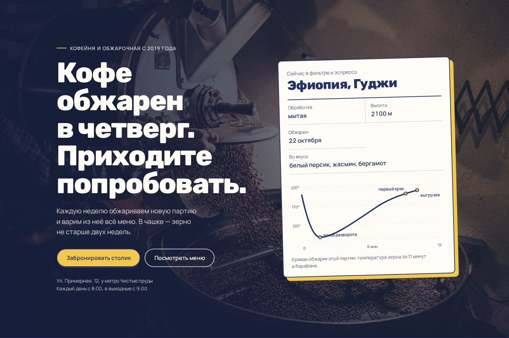
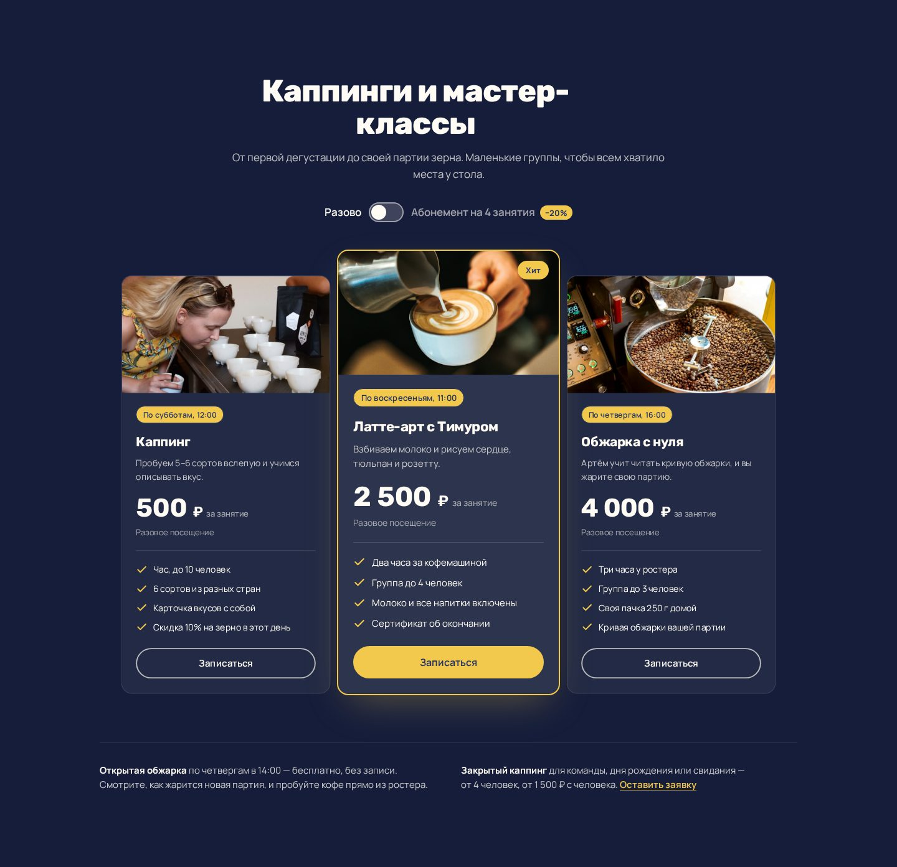
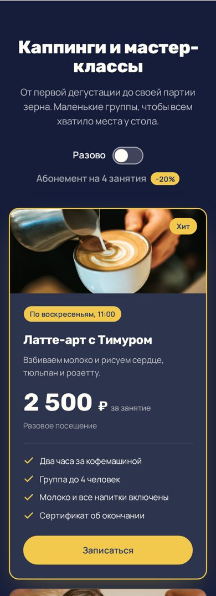
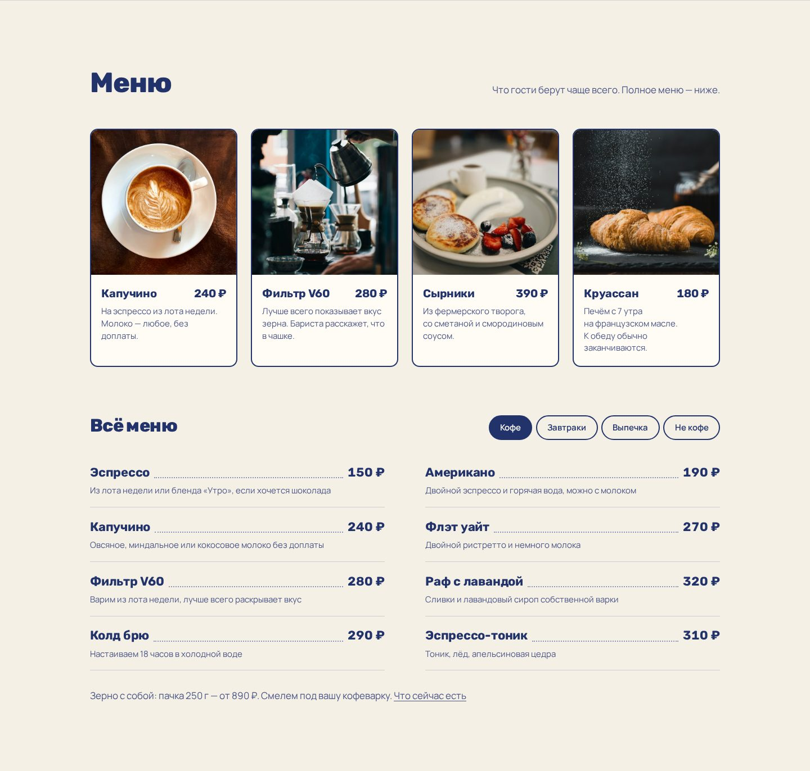

# ☕ Зерно — сайт кофейни-обжарочной

Одностраничный сайт для вымышленной кофейни со своей обжаркой: меню, свежая партия зерна, команда, мастер-классы и онлайн-бронь столика.
Написан на чистых HTML, CSS и JavaScript, без фреймворков и сборки.

**[Открыть сайт →](https://toctep-official.github.io/zerno/)**



## Что есть на сайте

- **3D-туннель на входе.** При прокрутке посетитель «пролетает» через фотографии кофейни.
- **Статус «Открыто до 22:00».** Считается по московскому времени, поэтому верен из любого города.
- **Карточка текущей партии.** Страна, обработка, вкус и SVG-график кривой обжарки.
- **Меню с вкладками:** кофе, завтраки, выпечка и «не кофе». Вкладки работают и с клавиатуры.
- **Мастер-классы в виде тарифов.** Переключатель «разово / абонемент», плавная смена цен и конфетти.
- **Ближайшие даты занятий.** Подставляются автоматически. Кнопка «Записаться» сама заполняет форму брони.
- **Форма брони.** Проверяет поля и подставляет маску телефона.
- **Отзывы со звёздным рейтингом**, частые вопросы, контакты.
- **Адаптивная вёрстка.** Анимации отключаются, если в системе включено «уменьшить движение».

<table>
  <tr>
    <td width="72%"></td>
    <td width="28%"></td>
  </tr>
</table>



## Как запустить

Скачайте репозиторий и откройте `index.html` в браузере. Устанавливать ничего не нужно.

```bash
git clone https://github.com/toctep-official/zerno.git
cd zerno
python3 -m http.server 8000   # или просто откройте index.html двойным кликом
```

## Структура

```
index.html          вся разметка страницы
css/style.css       стили; цвета и шрифты задаются переменными в начале файла
js/main.js          шапка, статус «открыто», вкладки меню, форма брони, появление блоков
js/tunnel.js        3D-туннель на первом экране
js/plans.js         переключатель «разово / абонемент» у мастер-классов
js/star-rating.js   звёзды в отзывах
img/                фотографии
docs/               скриншоты для этого README
```

## Технологии

HTML5 · CSS (Grid, Flexbox, custom properties, `clamp()`) · JavaScript без библиотек · шрифты Rubik и Manrope из Google Fonts

Блок мастер-классов сделан по мотивам компонента [Pricing от Codehagen](https://21st.dev/@Codehagen/components/pricing) с 21st.dev и переписан без React.

---

Кофейня, адрес и отзывы вымышлены: это учебный проект для портфолио.
